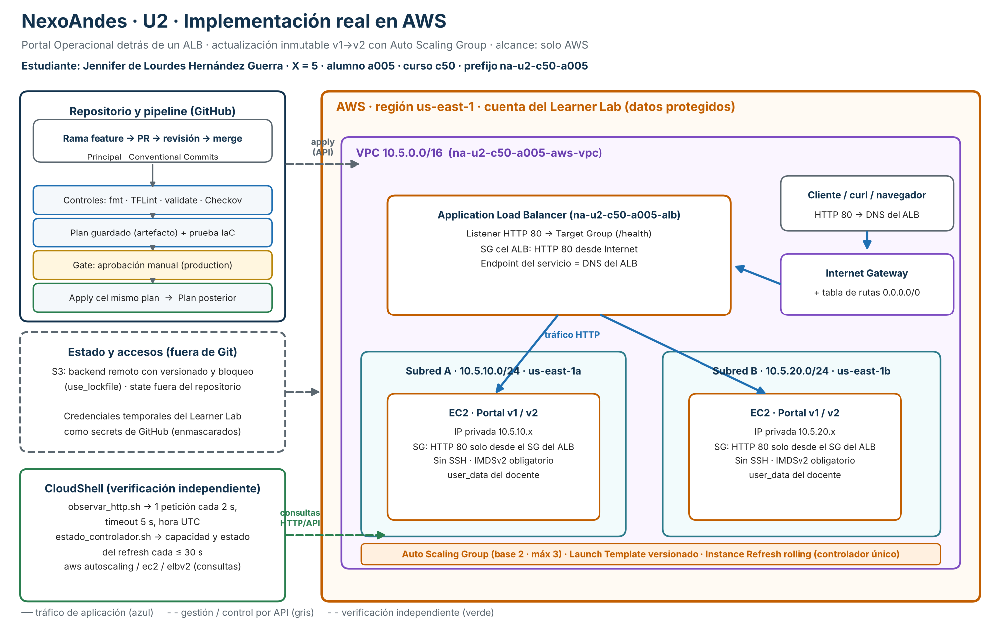

# NexoAndes U2 — Portal Operacional en AWS (actualización inmutable)

**Estudiante:** Jennifer de Lourdes Hernández Guerra · **Asignatura:** Automatización de Infraestructura con IaC (IC106TICL) · **Sección:** 50
**Identidad de laboratorio:** X = 5 · alumno `a005` · curso `c50` · prefijo `na-u2-c50-a005`

> **Alcance:** por indicación del docente en el chat del curso (Teams, fecha: _completar_), la evaluación se realiza únicamente en AWS.

## Arquitectura implementada



VPC `10.5.0.0/16` con dos subredes públicas en zonas distintas (`10.5.10.0/24` y `10.5.20.0/24`), Internet Gateway, Application Load Balancer (HTTP 80) y un Auto Scaling Group (base 2, máximo temporal 3) con Launch Template versionado e Instance Refresh rolling como controlador único del reemplazo.

## Estructura

| Ruta | Contenido |
|---|---|
| `environments/aws/` | Root module, backend S3, variables, outputs y plantilla `user_data_u2.sh.tpl` (artefacto docente) |
| `modules/aws_network/` | VPC, subredes, IGW, rutas, Security Groups y SG por defecto sin reglas |
| `modules/aws_compute/` | Launch Template (IMDSv2), ALB, Target Group, Listener y ASG |
| `.github/workflows/terraform.yml` | Pipeline: controles, plan guardado, gate, apply, plan posterior y destrucción controlada |
| `observacion/` | Scripts de la ventana de observación y analizador de apoyo |
| `docs/` | Diagrama y declaración de uso de IA |

## Entradas, derivados y salidas

- **Entradas:** `x`, `curso`, `build_ref` (commit), `portal_version` (`v1`/`v2`), `aws_region`, `instance_type`, `capacidad_base`, `capacidad_maxima`.
- **Derivados:** `alumno` (`a005`), prefijo, CIDR de VPC y subredes, tags (`proyecto`, `fase`, `alumno`, `curso`, `proveedor`) propagados a instancias y volúmenes.
- **Salidas:** `alb_dns_name`, `endpoint`, `asg_name`, `launch_template_id`, `launch_template_version`, `target_group_arn`, `vpc_id`, `subnet_ids`, `portal_version`, `build_ref`.

## Configuración del repositorio (sin secretos en Git)

- **Variables** (*Settings → Secrets and variables → Actions → Variables*): `X`, `CURSO`, `AWS_REGION`, `TF_STATE_BUCKET`.
- **Secrets** (credenciales temporales del Learner Lab, se renuevan en cada sesión): `AWS_ACCESS_KEY_ID`, `AWS_SECRET_ACCESS_KEY`, `AWS_SESSION_TOKEN`.
- **Environment `production`:** revisor obligatorio (gate) y bypass de administradores desactivado.
- **State:** bucket S3 con versionado y bloqueo (`use_lockfile`), fuera del repositorio.

## Operación

1. **Cambio de código:** rama `feature/...` → Pull Request → controles en verde → revisión escrita → merge a `Principal`.
2. **Desplegar/actualizar/recuperar:** *Actions → Terraform CI/CD U2 (AWS) → Run workflow* en `Principal`, con `portal_version` (`v1` o `v2`) y `aplicar` marcado. El apply usa el mismo plan que se revisó y se aprueba en el gate `production`.
3. **Plan posterior:** se ejecuta automáticamente y debe indicar que no hay cambios.
4. **Destruir:** *Run workflow* con `destruir` marcado → plan de destrucción revisable → gate → destrucción. Después, verificar con consultas independientes (ver ficha E08).

## Ventana de observación (CloudShell)

```bash
curl -O https://raw.githubusercontent.com/jhernandezguerra88-oss/evu2_hernandezguerra_jenniferdelourdes/Principal/observacion/observar_http.sh
curl -O https://raw.githubusercontent.com/jhernandezguerra88-oss/evu2_hernandezguerra_jenniferdelourdes/Principal/observacion/estado_controlador.sh
chmod +x *.sh
./observar_http.sh http://<dns-del-alb>/health muestras.csv          # pestaña 1
./estado_controlador.sh <asg-name> <target-group-arn> estado.log      # pestaña 2
python3 analizar_observacion.py muestras.csv --inicio <UTC> --estabilizacion <UTC> --estado estado.log
```

Cadencia: 1 petición cada 2 s con timeout de 5 s y sin reintentos; ventana desde inicio − 60 s hasta estabilización + 120 s; registro de capacidad y estado del controlador cada 25 s (máximo exigido: 30 s).

## Controles y excepciones justificadas

Fmt, TFLint, validate y Checkov (bloqueante) se ejecutan sobre todo el repositorio. Las excepciones de Checkov están documentadas junto a cada recurso con `#checkov:skip` y su razón:

| Control | Motivo |
|---|---|
| CKV_AWS_2, CKV_AWS_103, CKV_AWS_378, CKV2_AWS_20 | HTTP 80 por diseño (Anexo 1); no hay dominio ni certificado en el laboratorio |
| CKV_AWS_260 | Portal público por HTTP 80; la verificación independiente es externa |
| CKV_AWS_130 | Subredes públicas: el bootstrap requiere IP pública e Internet Gateway |
| CKV_AWS_91, CKV2_AWS_28, CKV2_AWS_11 | Logs de acceso del ALB, WAF y flow logs de la VPC: fuera de alcance de la Fase U2 |
| CKV_AWS_150 | La protección contra eliminación impediría el destroy exigido al cierre |
| CKV2_AWS_5 | Los Security Groups se asocian en el módulo `aws_compute`; Checkov analiza el módulo de red de forma aislada |

## Mejoras futuras

Actualizar las acciones de GitHub a versiones sobre Node 24, fijar la imagen del runner (`ubuntu-24.04`) y habilitar HTTPS con dominio y certificado.
